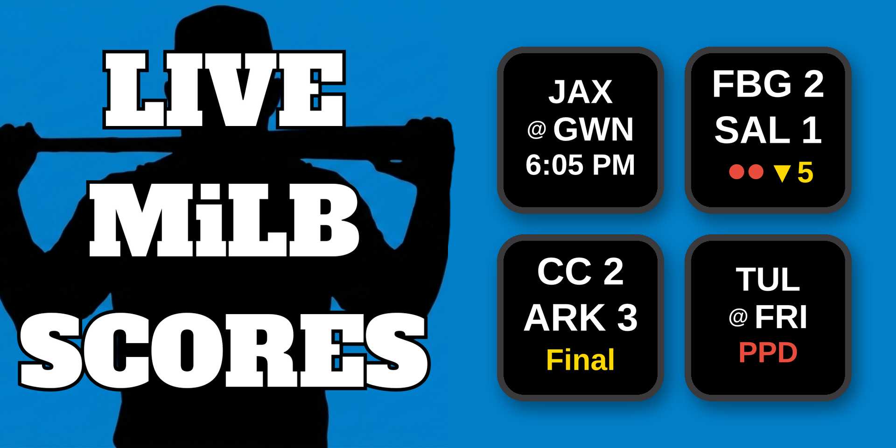
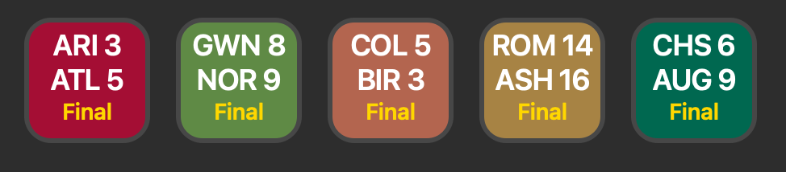
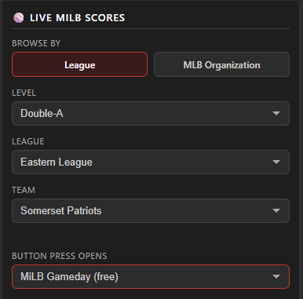
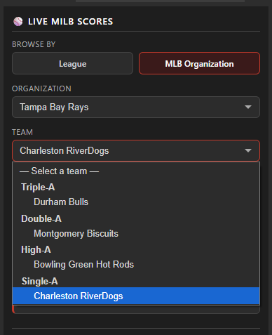
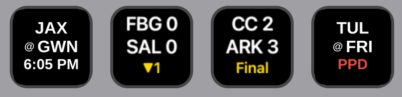

# Live MiLB Scores — Stream Deck Plugin



A Stream Deck plugin that shows live Minor League Baseball scores directly on your keys. Each key tracks one team and updates automatically every 30 seconds. Covers Triple-A through Single-A, the Arizona Fall League, and the winter leagues in Mexico, Venezuela, the Dominican Republic, Puerto Rico and Australia, plus the Caribbean Series.

  [](https://marketplace.elgato.com/product/live-milb-scores-c8a87c49-0980-4d7a-b8a4-b93334414733)

---

## Features

- **Live scores** — shows away score, home score, and current inning while a game is in progress
- **Fall and winter ball** — follow Arizona Fall League clubs and teams in the Mexican Pacific League (LMP), the Venezuelan league (LVBP), the Dominican league (LIDOM), the Puerto Rican league (LBPRC), the Australian Baseball League (ABL) and the Caribbean Series, with the same live scores, run cards and fireworks
- **Pre-game** — the two teams stacked (`CLT` over `@ JAX`) and the start time; on off days, your team's next game with its day and time
- **Final scores** — shows the final score with a "Final" label
- **Score-change flash** — when your team scores, the key blinks in its MLB parent organization's color (gray when the opponent scores), then shows a short card with the scoring team and how many runs scored (e.g. SWB / +2 RUNS)
- **Browser shortcut** — press any key to open that game on MiLB Gameday, MiLB.tv, or a custom link of your choice (e.g. your regional sports network); switches to Gameday automatically 30 minutes after the final out
- **Doubleheader support** — automatically shows Game 1, then switches to Game 2 when it ends; G1/G2 label keeps you oriented
- **Doubleheader toggle** — double-click a doubleheader key to peek at the other game; auto-reverts after 15 seconds
- **No-flicker updates** — keys only redraw when the display actually changes
- **Multi-key support** — add as many team keys as you want, each refreshes independently
- **Always up-to-date team list** — teams are loaded live from the MiLB API, so affiliate changes between seasons are reflected automatically
- **Search** — type a team, city, or mascot name to jump straight to it instead of drilling through League/Organization dropdowns
- **Next game on off days** — instead of a dead-end "No Game", the key shows your team's next scheduled game with its day and time
- **Custom key background color** — pick your own background color and opacity instead of the default black


*The Braves (left, Live MLB Scores) alongside four of their affiliates (Live MiLB Scores), each with its own custom key background color.*

---

## Recent Updates

**v1.0.39.0**
- New: three more winter leagues — the Puerto Rican league (LBPRC), the Australian Baseball League (ABL) and the Caribbean Series. Pick Winter Leagues in the Level dropdown, or just search a team (e.g. Santurce, Perth, Dominican Republic). Live scores, run cards and fireworks work the same as the other winter leagues
- No stream link yet for the Puerto Rican league, the Australian Baseball League or the Caribbean Series: for those teams the stream option is greyed out with a note, and the key opens Gameday (Custom Link still works)
- The amber "not live" dot now shows only on keys whose own team's data is stale, instead of on every key when any one feed hiccups

**v1.0.38.0**
- Fixed: "today" is now read in Eastern time, which is how MLB dates its schedule. Outside the US the keys could ask for tomorrow's slate while tonight's games were still on. The day now changes at 5:00 AM Eastern (2:00 AM Pacific), so late games and their finals stay on the keys overnight everywhere
- If MLB's data stops responding for a moment, keys keep showing the last scores with a small amber dot instead of "Err" (after 10 minutes without an update they show "Err")

**v1.0.37.0**
- New: winter leagues — follow any team in the Mexican Pacific League (LMP), the Venezuelan league (LVBP) or the Dominican league (LIDOM). Pick Winter Leagues in the Level dropdown, or just search a team (e.g. Culiacan, Leones). Live scores, run cards and fireworks work the same as the AFL
- Winter league keys open the game on MLB.com Gameday; the stream option opens the game's own MLB.TV stream once it starts (LMP and LIDOM games; if the stream can't be found, MLB.TV's featured games list). Venezuelan games aren't on MLB.TV, so for those teams the stream option is greyed out with a note, and the key opens Gameday (Custom Link still works)
- Now runs on Node.js 24 and needs Stream Deck 7.1 or later (Elgato is retiring Node.js 20)

## Requirements

- [Elgato Stream Deck](https://www.elgato.com/stream-deck) hardware
- [Stream Deck software](https://www.elgato.com/downloads) version 7.1 or later (Mac or Windows)
- No account required to view scores — the plugin uses MLB/MiLB's free public stats API
- A MiLB.tv subscription is required only if you choose the MiLB.tv link option; Gameday is free

---

## Installation

**Elgato Marketplace (recommended)**

1. Open **[Live MiLB Scores on the Elgato Marketplace](https://marketplace.elgato.com/product/live-milb-scores-c8a87c49-0980-4d7a-b8a4-b93334414733)** and install it from there
2. The plugin will appear in the Stream Deck action picker under **Live MiLB Scores**

**Manual install**

1. Download the latest **`Live MiLB Scores.streamDeckPlugin`** from the [Releases](../../releases) page
2. Double-click the file — Stream Deck will install it automatically

---

## Setup

1. Drag the **Live MiLB Scores** action onto any key
2. In the settings panel on the right, either type your team into the **Search** box for autocomplete, or browse for it manually:

**Browse by League** — drill down by level, then league, then team:

| Level | Leagues |
|-------|---------|
| Triple-A | International League, Pacific Coast League |
| Double-A | Eastern League, Southern League, Texas League |
| High-A | Midwest League, Northwest League, South Atlantic League |
| Single-A | California League, Carolina League, Florida State League |
| Arizona Fall League | Arizona Fall League (October–November) |
| Winter Leagues | Mexican Pacific League (LMP), Venezuelan League (LVBP), Dominican League (LIDOM), Puerto Rican League (LBPRC), Australian Baseball League (ABL), Caribbean Series (October–February) |



**Browse by MLB Organization** — pick an MLB parent club to see all of their affiliates grouped by level. (Arizona Fall League and winter league clubs aren't tied to a single MLB organization, so they're only under Browse by League and search.)



3. Choose what happens when you press the key:
   - **MiLB Gameday (free)** — opens the game's Gameday page on MiLB.com (winter league teams open the game on MLB.com Gameday)
   - **MiLB.tv (subscription)** — opens the live stream page on MiLB.com
     (for Arizona Fall League teams this option reads **AFL Live Stream (free on MLB.com)** and opens that game's free stream on MLB.com, or the AFL live-streams page if the stream isn't up yet; for Mexican and Dominican winter league teams it opens the game's MLB.TV stream once it starts; Venezuelan, Puerto Rican, Australian and Caribbean Series games have no stream link, so that option is greyed out for those teams)
   - **Custom Link** — opens any URL you enter, such as your regional sports network's live-game page

That's it. The key will load your team's game within a few seconds and refresh every 30 seconds from there.

> **Note:** If MiLB.tv or Custom Link is selected but the game hasn't started yet, pressing the key opens Gameday instead — a Custom Link with no URL entered behaves the same way. After the final out, the key continues opening MiLB.tv/your custom link for 30 minutes to cover post-game coverage, then automatically switches to Gameday.

---

## What the Key Shows



**Before the game:**
```
CLT
@ JAX
7:05 PM
```

**Live game:**
```
CLT 3
JAX 1
 ▲5
```

**Final score:**
```
CLT 3
JAX 1
Final
```

**Off day** (your team's next game — the weekday, or the date when it's a week or more away):
```
CLT
@ JAX
Thursday
7:05 PM
```

---

## How It Works

The plugin polls [MLB's free public Stats API](https://statsapi.mlb.com) once every 30 seconds per key using sport IDs for all four MiLB levels (Triple-A through Single-A), the Arizona Fall League and the Mexican, Venezuelan, Dominican, Puerto Rican and Australian winter leagues and the Caribbean Series. No API key or account is required. The plugin is fully self-contained — it uses only Node.js built-in modules and requires no external dependencies.

---

## Uninstalling

Open Stream Deck → Preferences → Plugins, select **Live MiLB Scores**, and click the **−** key.

---

## Contributing

Bug reports and feature requests are welcome — open an [Issue](../../issues) to get started.

---

## Disclaimer

This plugin is not affiliated with, endorsed by, or sponsored by Major League Baseball or MLB Advanced Media, L.P. All data is sourced from the MLB Stats API and is subject to MLBAM's terms of use. This plugin is intended for individual, personal, non-commercial use only.

---

## Credits

Created by **T.J. Lauerman aka ThatSportsGamer**

Created with Claude Cowork by Anthropic

Data provided by the [MLB Stats API](https://statsapi.mlb.com)
